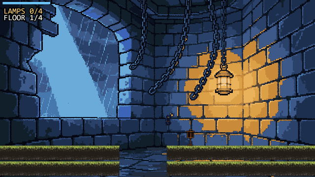
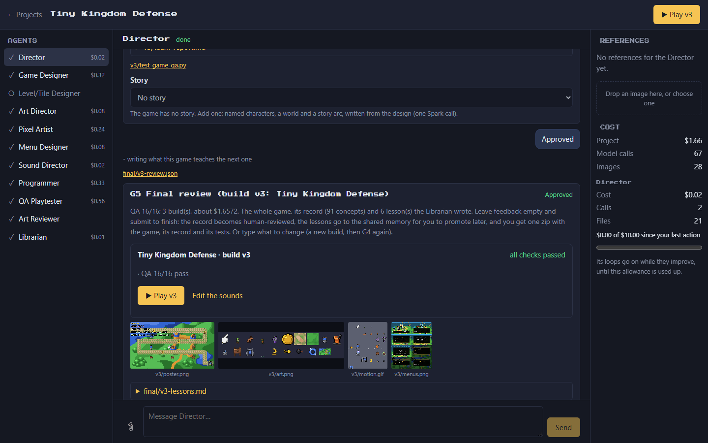
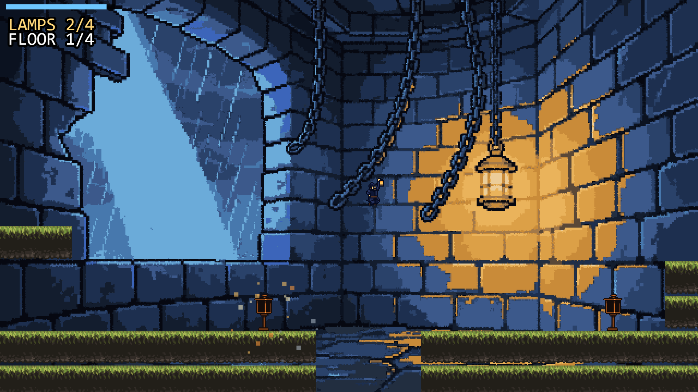
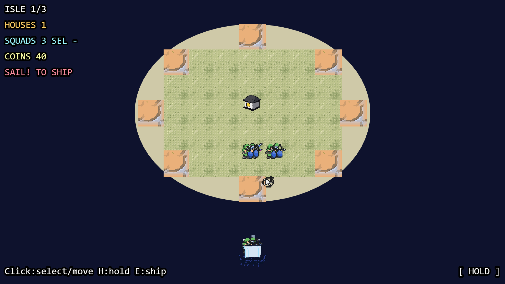
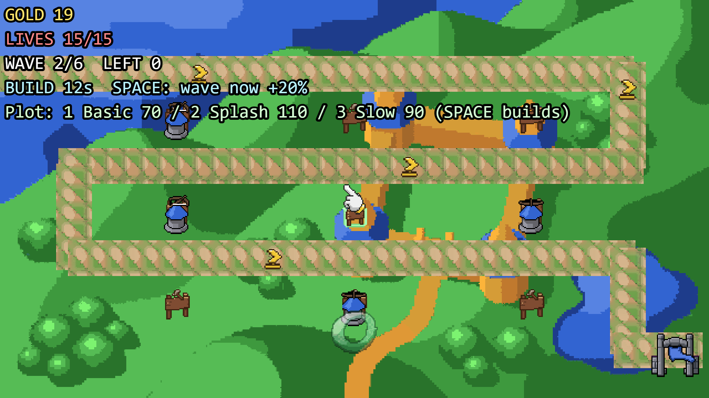
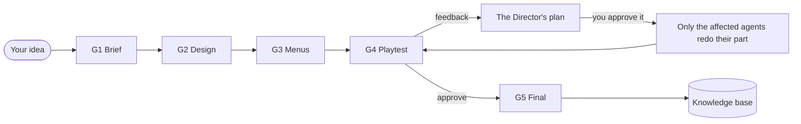

# SpriteForge

**Describe a game in a sentence. A team of AI agents builds a playable 2D pixel-art browser
game, and you approve every step.**



SpriteForge runs on your own machine. **Muse Spark** plans, designs, writes and repairs the
game; **Muse Image** draws and revises its art. Eleven role-based agents carry the game from
brief to finished build and pause at five human gates. Each finished game teaches the harness:
its lessons go to a local, auditable knowledge base that later builds read once you promote
them.

Built for the Meta Global AI Developer Hackathon (Oct 26 - Nov 4, 2026).

## Highlights

- **A studio, not a prompt box.** A chat-first local UI shows the agents in the order they
  work. Chat with any of them, give them reference images, or stop a run and send it back to
  an earlier step.
- **You decide, the agents work.** Five gates: brief, design, menus, playtest, final. Feedback
  in plain words goes only to the agent it is about, and after a playtest the Director shows
  its plan for your feedback before anything is rebuilt.
- **Real games.** Full-HD (1920x1080) Phaser 3 games with menus, saved progress, synthesised
  sound and a sound editor, exported as a static site with their own pytest + Playwright
  tests. Side-view games get levels written as data and proven clearable by code.
- **Code checks what models write.** Palettes, sprite grids, tile seams, level reachability,
  menu flow and jump physics are checked deterministically, and a bot plays every level
  before you do.
- **Costs you can see.** Every Muse call is metered in a durable ledger, and each agent has its
  own $10 allowance.
- **Runs offline.** Mock providers stand in for Muse, so the whole pipeline and its 525 tests
  run without a key.



## Games made with SpriteForge

Each started as one sentence, went through all five gates, and was played and approved by a
human. Every sprite, tile and title picture is Muse Image art or CC0/free-to-use library art.

Play them in your browser on itch.io:

| | Game | Genre | Builds | Muse cost |
| --- | --- | --- | --- | --- |
|  | **[Stormlight Keeper](https://reviver1234.itch.io/stormlight-keeper)**: climb a storm-battered lighthouse and relight its lamps before the ship hits the rocks | Side-scrolling platformer | 3 | $1.77 |
|  | **[Pale Shores: Three-Isle Hold](https://reviver1234.itch.io/pale-shores-three-isle-hold)**: command small squads against Viking landings across three islands | Real-time island defence | 10 | $4.89 |
|  | **[Tiny Kingdom Defense](https://reviver1234.itch.io/tiny-kingdom-defense)**: build basic, splash and slow towers along a winding path for six waves | Tower defense | 3 | $1.66 |

Gameplay clips: [Stormlight Keeper](https://github.com/reviver134/spriteforge/blob/master/docs/media/stormlight-keeper.gif) ·
[Pale Shores](https://github.com/reviver134/spriteforge/blob/master/docs/media/pale-shores.gif) ·
[Tiny Kingdom Defense](https://github.com/reviver134/spriteforge/blob/master/docs/media/tiny-kingdom-defense.gif)

The builds count feedback rounds: Pale Shores took ten because a human playtest found the squads
too weak to win, twice, and each round went back through the Director's plan. Two harness
checks came out of these games: a HUD check (texts drawn over each other or off the screen fail
the playtest) and a tile check (a ground tile drawn as an object on a background is redrawn).

## How a game gets made



| Gate | You see | What happens before it |
| --- | --- | --- |
| **G1 Brief** | A short questionnaire for your genre | The Director picks one of 11 genre kits and the questions that matter for it |
| **G2 Design** | Research, the game plan, the design (and a story, if you asked), every agent's task list | The Game Designer studies similar games with Muse Spark web search, writes a numbered plan that code checks, then the design |
| **G3 Menus** | Every screen of the game and its title art | The Menu Designer writes the menus as data; Muse Image draws the title art |
| **G4 Playtest** | A play link, the art sheet, animations, the build report, each agent's report | Art comes from the local library or Muse Image; for a side-view game the Level/Tile Designer writes levels that code proves clearable; the Programmer writes Phaser code against a small SDK; a bot plays every level; the QA Playtester's tests run with real key presses; failures go back for repairs; the Art Reviewer (Spark vision) checks the art in the running game |
| **G5 Final** | The whole game, its cost, and the Librarian's lessons | Approval exports the game and its full record |

At any gate, write feedback in plain words ("the slime should jump higher", "the splash is too
loud"). The Director splits it into design, art, code, level, menu, sound, story and QA changes
and routes each to its agent; only that part is redone. At G4 and G5 its reading is shown
first, as a plan: submit it empty to approve, or type what the Director got wrong and it plans
again. Nothing is built until you approve.

In the studio you can also:

- **chat with any agent:** a question is answered from that agent's own work; a change is filed
  into its part of the next revision;
- **go back:** changing work that is already done stops the agent working now and rewinds the
  run to the step the change is about (calls already paid for are kept and cached);
- **give references:** images for one agent or for all of them (Spark sees them; the art
  agents' references steer Muse Image's style);
- **apply an Art Reviewer suggestion** with one click, or send feedback for one level only.

## How SpriteForge uses Muse

| Agent | Muse | Its job |
| --- | --- | --- |
| Director | Spark | Picks a genre and the brief's questions; turns your feedback into a plan of changes per agent |
| Game Designer | Spark, web search | Studies similar games online; writes the game plan, the design and, on request, a story |
| Level/Tile Designer | Spark, web search | Studies the level design of similar games; writes each level as data |
| Art Director | Spark | Picks library art; writes every entity's animation rows, forms and effects |
| Pixel Artist | Muse Image | Draws sprite sheets (a row of frames per animation), the title background and an emblem |
| Menu Designer | Spark | Writes every menu screen as data |
| Sound Director | Spark | Picks a synthesised sound for every moment of the game |
| Programmer | Spark | Writes the Phaser 3 game against a small SDK, then repairs it from what failed |
| QA Playtester | Spark | Writes tests played with real key presses, and code checks for each game |
| Art Reviewer | Spark vision, Muse Image edits | Reviews the art in screenshots of the running game and fixes blocking issues |
| Librarian | Spark | Writes the lessons each finished game teaches; describes library art (vision) |

The Muse features the harness relies on, each verified with live calls (the notes are in
`src/spriteforge/config.yaml`):

- strict `json_schema` output for every design, plan, level, menu and code file set;
- `reasoning_effort` per task: low for routing, high for design and code, max for the art
  review;
- prompt caching: prompts lead with their stable part and send a `prompt_cache_key` per task;
- web search through the Responses API, with every URL the research cites checked against the
  pages the search returned;
- vision: screenshots of the running game, library art and your reference images;
- Muse Image generations and edits at the high setting, with reference images and a
  content-addressed cache, so an identical request is never paid for twice;
- tool use: in a live build, agents call their granted MCP tools and load skills before they
  answer.

## Principles

- **Models propose; code enforces.** Palettes, sprite sizes, tile seams, jump physics, menu
  reachability and QA tests are checked by code, not trusted.
- **Accepted art is locked.** Muse Image has no seed, so approved assets are never regenerated
  unless you ask for a change to them.
- **Caps stop loops, not you.** Each agent may spend $10 (`budget.max_agent_cost`) since your
  last action; its loops (repairs, redraws, review rounds) go on while they improve, until that
  is used up. Work you ask for always starts. `spriteforge report RUN_ID` shows calls, tokens
  and cost.
- **Local-first.** All data stays in a workspace folder. The API key is read from the
  environment and scrubbed from logs, memory and exports.
- **Auditable learning.** Knowledge is plain Markdown in a git repo (OKF format). Lessons the
  agents write stay "generated" until a human promotes them.
- **Extensible.** Agent roles are Markdown files; skills (SKILL.md folders) and MCP servers are
  granted per agent.

## Quick start

Requires Python 3.11+. Node.js is optional (used to syntax-check generated code).

```bash
pip install spriteforge
python -m playwright install chromium
```

To work on SpriteForge itself, install from a clone instead (this also gets you the tests and
the CC0 art packs in `assets/library/`):

```bash
git clone https://github.com/reviver134/spriteforge.git && cd spriteforge
python -m venv .venv && . .venv/bin/activate     # Windows: .venv\Scripts\activate
pip install -e ".[dev]"
python -m playwright install chromium
```

Installed with pip, the art library lives in `~/spriteforge-workspace/library` (or the folder
`SPRITEFORGE_LIBRARY` names) and starts empty: add packs with `spriteforge library add`, or let
Muse Image draw everything.

**Offline (no key):**

```bash
python -m spriteforge start --agents --mock --workspace workspace
```

**Live with Muse:** put your key in the environment or in a `.env` file in the folder you start
from (in a clone, `.env` is gitignored), then start without `--mock`:

```bash
echo META_API_KEY=your-key > .env
python -m spriteforge start --agents --workspace workspace --goal "a slime that squishes through a cave"
```

The studio opens at <http://127.0.0.1:8765> (the previous UI stays at `/classic`), and
`python -m spriteforge` on its own opens it for every project in the workspace: describe a new
game there (without a key it offers the offline mock), and several projects can run at once.
It serves localhost only and refuses cross-site requests. Stop the process at any gate and pick
up later:

```bash
python -m spriteforge runs --workspace workspace
python -m spriteforge resume RUN_ID --workspace workspace
```

**Without the UI:** design, art, code, playtest and repair in one command:

```bash
python -m spriteforge game make "a 10 minute top-down survival game" --out out/survival
python -m spriteforge game make "a slime arena" --out out/slime --mock
```

## What you get

Each run lives in `workspace/runs/RUN_ID/`. A finished game (`game/vN/`) is a static Phaser 3
site with no build step: open `index.html` over any static server, or host it anywhere.

- `export.zip`: the build, its QA tests (`pytest build/tests`) and its full record.
- `sounds.html`: a sound editor. All sound is synthesised in the browser (no audio files).
- `game/db/`: the game's record as an OKF bundle (design, entities, art, code, QA, builds,
  your decisions), readable by agents through read-only MCP tools
  (`spriteforge game db mcp workspace/runs/RUN_ID`).

In the game: arrows/WASD and Enter, Escape pauses, M toggles sound. `?play=1` skips the title,
`?reset=1` clears saved progress.

## Knowledge, skills and tools

```bash
python -m spriteforge memory --help                         # search, validate, promote lessons
python -m spriteforge memory promote lessons/<id> --by you  # let later games use a lesson
python -m spriteforge skills --help                         # add SKILL.md folders, grant per agent
python -m spriteforge mcp --help                            # add MCP servers, grant per agent
python -m spriteforge library --help                        # local art packs with license tracking
```

Agent roles are Markdown files in `src/spriteforge/agents/roles/`; built-in skills are in
`src/spriteforge/skills/builtin/`, including seven open-source game-development skills (level
design, platformer, puzzle, game feel, physics tuning, audio design, game UI/UX; Apache-2.0)
granted to the agents they suit.

In a live build each agent may look things up before it answers (up to `game.tool_rounds`
rounds): the built-in MCP tools its role grants (`library.*` for the art library, `game_db.*`
for the game's record), its skills (`load_skill`), and your MCP tools granted to it that you
set to run without confirmation. Each lookup shows in the agent's chat. `game.agent_tools:
false` turns this off (one call per answer).

MCP server templates are in `src/spriteforge/mcp/templates/`. The official fetch server lets
agents read public web pages (needs `uv`; it refuses private and local addresses):

```bash
python -m spriteforge mcp add fetch src/spriteforge/mcp/templates/fetch.json
python -m spriteforge mcp inspect fetch
python -m spriteforge mcp enable fetch --role "Level/Tile Designer"
python -m spriteforge mcp policy fetch fetch --no-confirm   # builds use only tools that do not ask
```

The Context7 server gives the Programmer the Phaser 3.90 documentation (needs Node.js; the
questions go to context7.com; an optional free `CONTEXT7_API_KEY` raises its limits):

```bash
python -m spriteforge mcp add context7 src/spriteforge/mcp/templates/context7.json
python -m spriteforge mcp inspect context7
python -m spriteforge mcp enable context7 --role Programmer
python -m spriteforge mcp policy context7 resolve-library-id --no-confirm
python -m spriteforge mcp policy context7 query-docs --no-confirm
```

`python -m spriteforge mcp disable NAME` takes a server away again.

## Configuration

`src/spriteforge/config.yaml` (or your own file with `--config`) holds the endpoints, the model
ids (`muse-spark-1.3`, `muse-image-1.0`), the reasoning effort per task and these switches:

| Key | Default | What it does |
| --- | --- | --- |
| `budget.max_agent_cost` | `10` | USD each agent may spend since your last action |
| `game.patience` | `2` | An agent's loop stops after this many tries in a row without improvement |
| `game.screen_scale` | `6` | 320x180 design pixels times this: 6 is 1920x1080, 4 is 1280x720 |
| `game.image_reasoning` | `high` | Muse Image's setting for every first draw |
| `game.review` | `true` | The Art Reviewer checks the art before G4 |
| `game.agent_tools` | `true` | Agents may call MCP tools and load skills in a live build |
| `game.hud_check` | `true` | The bot playtest fails a build whose HUD texts cover each other or run off the screen |

## Project layout

```
src/spriteforge/
  agents/     role prompts (Markdown), router, agent runtime
  app/        FastAPI server, the built studio (static/) and the classic page
  core/       state (SQLite), gates, cost ledger, secret scrubbing
  providers/  Muse Spark, Muse Image, web search, and mock providers
  stages/     the gated workflow: brief, design, menus, playtest, final, rewind
  game/       design, levels, art, code generation, the game SDK, menus, sounds, QA, export
  pixel/      deterministic pixel tools: grid detection, palettes, seams, atlases
  memory/     OKF knowledge base
  library/    local art packs with license tracking
  skills/     SKILL.md folders granted per agent
  mcp/        MCP servers and templates granted per agent
ui/           the React studio (Vite, TypeScript); its build is committed to app/static/
tests/        pytest + Playwright, offline
docs/         engineering notes: levels, QA code checks, the Sound Director, the studio
tools/        live-run, font and art-library helpers
```

## Tests

```bash
python -m pytest -q
```

The tests use mock providers and make no network calls; the browser tests need the Chromium
installed above.

## Developing the studio UI

The React studio lives in `ui/` (Vite, React 18, TypeScript). Its build is committed to
`src/spriteforge/app/static/`, so running SpriteForge never needs Node.

```bash
cd ui && npm ci
npm run dev     # http://localhost:5173, proxies /api to a running `python -m spriteforge`
npm run build   # type-checks, then rewrites src/spriteforge/app/static/
```

## License

SpriteForge is released under the [MIT License](https://github.com/reviver134/spriteforge/blob/master/LICENSE). Bundled third-party parts keep their
own licenses:

- Phaser 3.90.0 (MIT) in `src/spriteforge/templates/phaser/vendor/`;
- the Press Start 2P font (SIL OFL 1.1, license next to it) in the studio build;
- seven skills from [awesome-gamedev-agent-skills](https://github.com/gamedev-skills/awesome-gamedev-agent-skills)
  (Apache-2.0, see `src/spriteforge/skills/builtin/THIRD_PARTY.md`);
- art packs in `assets/library/`, tracked by license: only packs verified as redistributable
  (CC0 here) are committed; the rest stay on your machine and are listed in
  `assets/library/.gitignore`.
